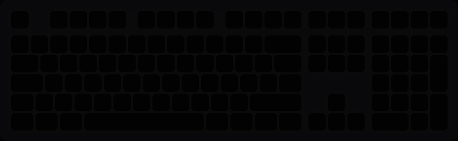
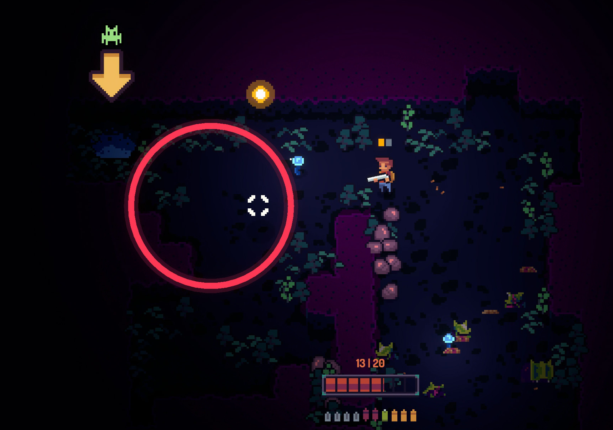

# gifobModding

Mods for Game is Full of Bugs, built on BepInEx 5.

## WootingRGB

RGB effects for your Wooting keyboard.

| | |
|---|---|
| Flashes red when hit |  |
| White sweep when reloading |  |

## Mortar AOE location

Displays the location of where the mortar AOE will hit.

## Install

1. Install [BepInEx 5](https://github.com/BepInEx/BepInEx/releases) (x64) into the game folder.
   On Linux (Proton), set the Steam launch option `WINEDLLOVERRIDES="winhttp=n,b" %command%`.
2. Copy the mod's DLL into `BepInEx/plugins/`.

## Build

Needs the .NET SDK and the game installed.

    dotnet build wootingRGB -c Release

If the game is not in the default Steam library, add `-p:GameDir="/path/to/GiFoB_pc"`.
The output folder is set in `Directory.Build.props`.

## Testing
All the mods have been built and tested on the demo, under Proton
